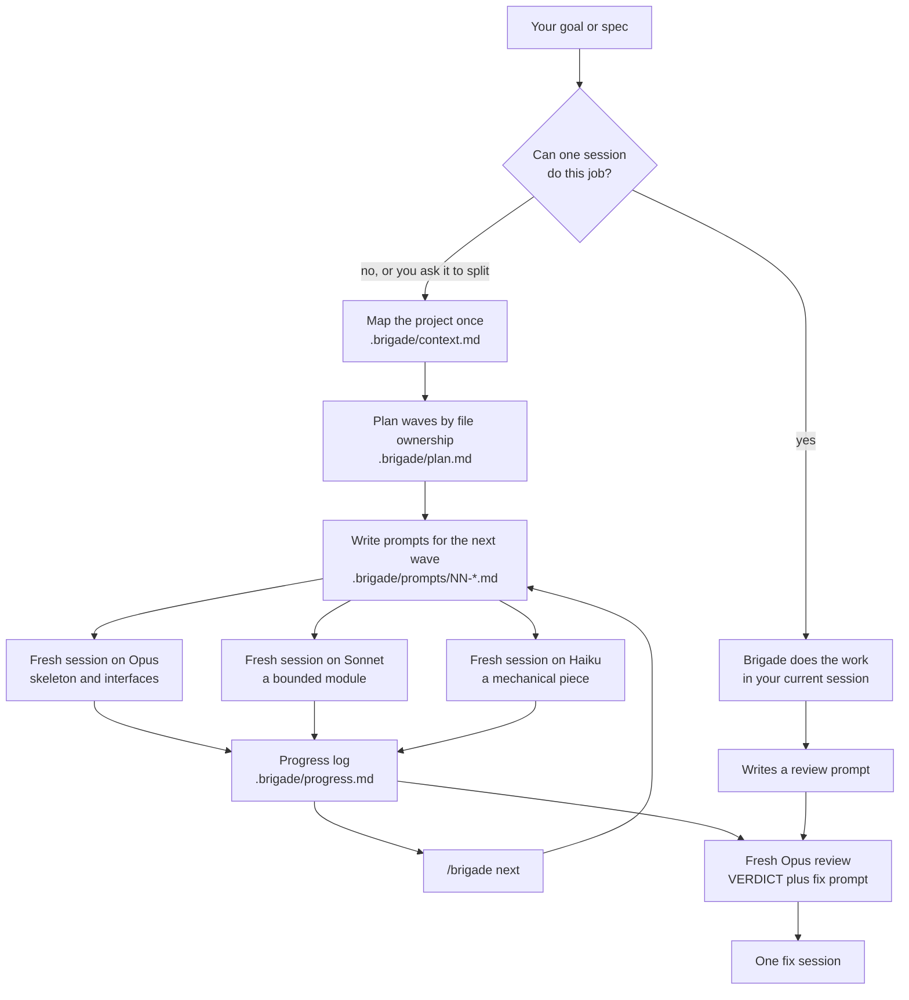

# Brigade

**Plan big Claude Code jobs the way a kitchen brigade runs a service:** one
planner, a station for each part of the work, the right cook at each
station, and a final check before anything leaves the pass.

Brigade is a Claude Code skill. Give it your project goal and it decides
whether the job needs more than one session. If it does, it cuts the work
into pieces that each fit in a fresh session, writes a self-contained prompt
for each piece, and picks a model for each piece by risk. Every job ends
with a review prompt for a fresh session that didn't write the code.

It works on any Claude Code plan (Pro, Max, Team), in the terminal and in
VS Code, and it doesn't need an API key.

## Architecture



Brigade is built from six parts. Each one fixes a specific way that big jobs
go wrong in a single long session.

### 1. A project map instead of rediscovery

Each fresh session starts with no memory, and having it re-read the whole
codebase is slow and makes it drift from the plan. Brigade writes
`.brigade/context.md` once. It holds the layout, the commands, the
conventions, and the **interfaces between parts**, which act as the
contract. Every session reads this map first. In the example build it was
77 lines.

### 2. Pieces cut by file ownership

Split work breaks when two sessions edit the same file. Every piece in
Brigade owns a fixed set of files and may not touch any other. Shared files
such as routers and config belong to exactly one piece.

### 3. Waves, with prompts written just in time

Pieces are grouped into waves by dependency. Wave 1 is usually the skeleton
and the interfaces; later waves fill in modules behind them. Brigade writes
full prompts only for the next wave. When a wave finishes,
`/brigade next` reads what was actually built and writes the next
wave's prompts from that. Prompts written before the code exists go stale.

### 4. Self-contained prompts that settle the details

Each prompt lists what to read, what to build, which files it owns, the
interfaces it must keep, an exact done-check, and when to stop and ask
instead of guessing. The hard decisions are made in the prompt, not left to
the worker. [See a real one](examples/ledger/prompts/02-importers.md): it
pins down money parsing, line numbers in errors, atomic imports and the
duplicate rules before any code is written.

### 5. A model for each piece, chosen by risk

For each piece Brigade asks two questions: how bad would a mistake be, and
would the piece's check catch it right away?

| The piece is... | Model |
|---|---|
| Mechanical, fully specified, mistakes caught by its check | Haiku, low effort |
| Bounded with a clear spec and a check that would catch a mistake | Sonnet, medium |
| Auth, money, data, migrations, concurrency, interfaces others build on, or a mistake would go unnoticed | Opus, medium |

A mistake that a test catches immediately costs one retry. A silent mistake
gets built on by every piece that follows. If a piece fails its check, it is
rerun one model up (Haiku, then Sonnet, then Opus), never twice on the same
model. Every choice is written down with its reason in
[plan.md](examples/ledger/plan.md).

### 6. A fresh-context review

A session reviewing its own work shares its own blind spots. Brigade's last
step is a review by an Opus session that never saw the code being written.
It reads the plan, the map and the full diff, runs the checks, and lists
defects with file:line. It ends with `VERDICT: CLEAN` or `VERDICT: DEFECTS`
and a ready-to-run fix prompt.

### Everything lives on disk

```
.brigade/
├── context.md      the project map and interface contract
├── plan.md         waves, file ownership, model per piece and why
├── progress.md     what each session reported when it finished
└── prompts/
    ├── 01-skeleton.md
    ├── 02-importers.md
    └── review-final.md
```

Nothing depends on one long conversation surviving. You can stop between
any two pieces and pick up later, or hand the remaining pieces to a teammate.

## Measured quality improvement

Each setup built the same project from the same brief: `ledger`, a
personal-finance toolkit with SQLite storage, two bank CSV importers, a
rules engine, budgets and a CLI. One build was a normal Claude Code session
(Opus 5.5); the other was Brigade, split into fresh sessions. Correctness
was checked with 32 hidden tests the sessions never saw.

**Both builds passed all 32 hidden tests and their own test suites.** The
difference showed up in the edge cases. Brigade's fresh-context review found
five ways the code broke the spec, and I then tested both builds against
those five inputs:

| Input | Normal session | Brigade, after review and fix |
|---|---|---|
| A 29-digit amount in a bank file | crash with traceback | clean error naming the line |
| A 21-digit amount in a bank file | crash with traceback | clean error naming the line |
| An amount written in non-ASCII digits | accepted as money | rejected as malformed |
| A budget of `1e30` | clean error | clean error |
| A rule priority past the 64-bit range | crash with traceback | clean error |
| **Handled correctly** | **1 of 5** | **5 of 5** |

The spec said errors must never print a traceback. The normal session broke
that rule three times, and its own tests didn't catch it.
[Read the review that found these](examples/ledger/review-final-output.md).

The architecture held up in practice too:

- **All four pieces given to Sonnet passed first time,** with no escalations.
  The project map and the self-contained prompts were enough.
- **Every piece stayed in its lane.** Each one's progress report lists only
  its own files, plus decisions it appended to context.md, and no piece
  changed an interface.
- **It knows when not to split.** On every job one session could handle, up
  to that five-module build, Brigade said so and did the work itself. It
  did this in 5 of 5 runs.

## When to use it

- **Use it for jobs too big for one session:** many subsystems, or long
  enough that the context fills up. Also use it for risky work where you
  want a review by a session that didn't write the code.
- **On small jobs it just does the work** and leaves you a review prompt.
- **Splitting runs more sessions than doing the job in one,** so on a job
  one session could handle it takes longer and uses more of your plan. Ask
  it to split only when the job needs it.

## Install

**VS Code, one click:** paste this link into your browser. Add the marketplace
when asked, choose **Install for you**, and restart Claude when prompted.

    vscode://anthropic.claude-code/install-plugin?plugin=brigade&marketplace=rajvardhan19/brigade

**VS Code, by hand:** type `/plugins` in a Claude Code chat. In the
**Marketplaces** tab, add `rajvardhan19/brigade`, then install **brigade** from
the **Plugins** tab.

**Terminal:**

    claude plugin marketplace add rajvardhan19/brigade
    claude plugin install brigade@brigade

**As a plain skill, without the plugin system:** copy
`plugins/brigade/skills/brigade` to `~/.claude/skills/brigade`.

**Command names.** This README writes the commands as `/brigade <goal>` and
`/brigade next`, the plain-skill names. Installed as a plugin, they carry the
plugin's prefix: `/brigade:brigade <goal>` and `/brigade:brigade next`.

To split a job that one session could do, add "Plan this as separate sessions"
to the goal.

## Running the pieces

To start a piece, use a terminal:

    claude --model sonnet --effort medium "Do brigade piece 02: follow .brigade/prompts/02-importers.md"

Or, in VS Code or the desktop app, open a new chat, pick the model, and send
the same sentence. When a wave is done, run `/brigade next`. Run the
review prompt in a new chat on Opus. If it says DEFECTS, run its fix prompt
once.

**See a full real run:** [examples/ledger](examples/ledger) has the plan,
the project map, every prompt, the progress log and the review, exactly as
Brigade wrote them.

## Known limits

- **Small sample:** 4 tasks and 11 runs, mostly single runs. The robustness
  comparison comes from one split run.
- **Untested on multi-hour jobs.** Brigade is designed for builds so large
  that one session's context fills up, and none of the test jobs were that
  big.
- **You coordinate.** You start each session and pick its model, and
  Brigade tells you exactly what to run.
- **Overlap with Claude Code Projects:** Projects (beta, claude.ai/code and
  the desktop app) also splits work into fresh threads. Brigade adds a model
  per piece, the review step, and support for the terminal and VS Code.

## Reproduce the tests

    python3 bench/run.py --tasks t6_ledger --arms baseline,brigade,brigade-forced --stage mine
    python3 bench/report.py mine

`bench/` contains the test projects, the task briefs, the hidden graders and
the raw results of every run.

## License

MIT
